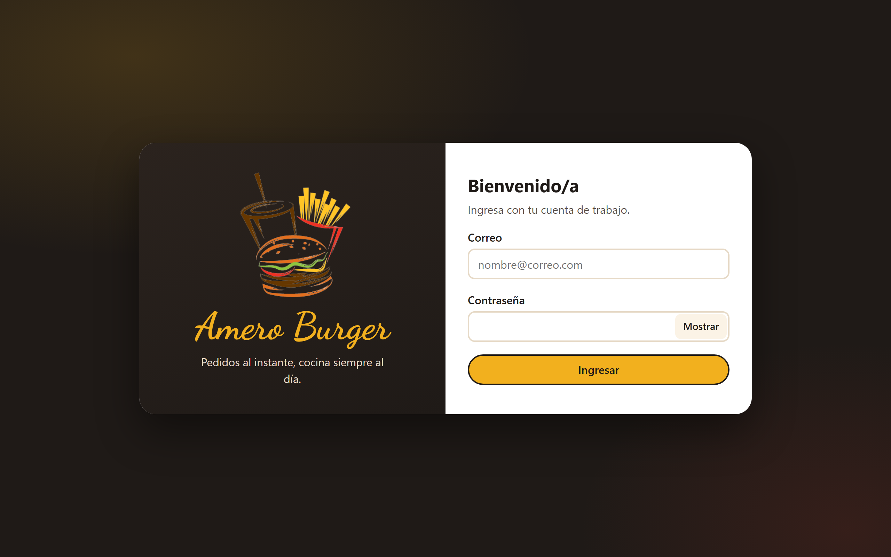
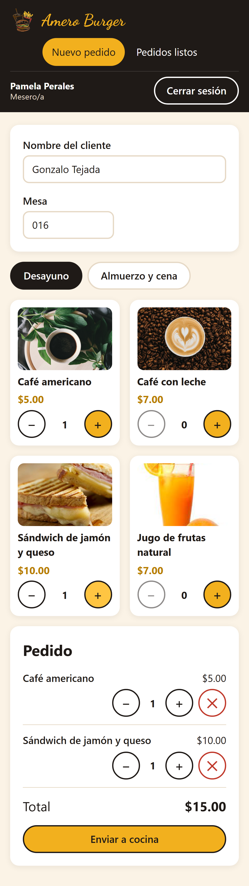
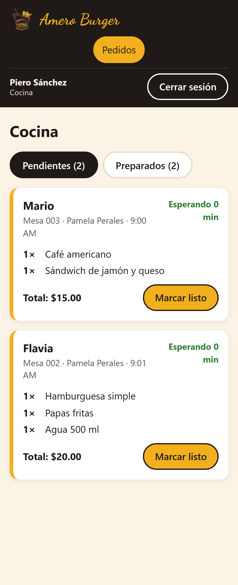
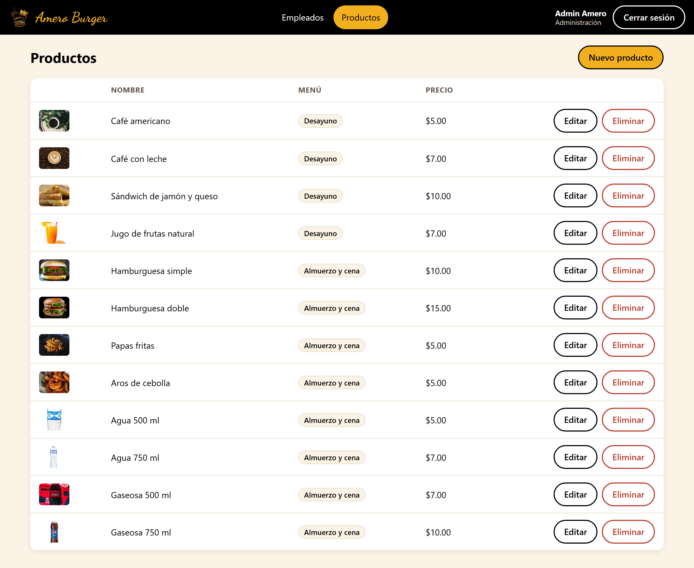

# 🍔 Amero Burger

Aplicación web para gestionar los pedidos de una hamburguesería: el mesero toma la orden, la cocina la prepara y el administrador mantiene el menú y el equipo. Proyecto de Laboratoria (LIM018) hecho en **Angular 14**.

## 📸 Vistas de la aplicación

### Inicio de sesión


### Vista de Mesero


### Vista de Cocina


### Vista de Administrador


## ✨ Funcionalidades

| Rol | Qué puede hacer |
| --- | --- |
| **Mesero/a** | Ver el menú por categoría, armar el pedido con el carrito, indicar cliente, enviar a cocina y entregar los pedidos listos (`/waiter`, `/waiter/ready`). |
| **Cocina** | Ver los pedidos pendientes en tiempo casi real (se actualiza cada 10 s), marcarlos como listos y ver el tiempo de preparación (`/kitchen`). |
| **Administración** | CRUD de usuarios y de productos (`/admin/users`, `/admin/products`). |

Además: sesión persistente, rutas protegidas por rol, notificaciones (toasts), manejo de sesión expirada y formularios con validación.

## 🧱 Tecnologías

Angular 14 · TypeScript · RxJS · Reactive Forms · Karma + Jasmine · json-server (API simulada) · CSS propio.

## 🚀 Cómo ejecutarlo

Necesitas Node 16 o superior.

```bash
# 1) API simulada (puerto 8080)
cd json-server
npm install
npm start

# 2) Cliente (en otra terminal, puerto 4200)
cd burger-api-client
npm install
npm start
```

Abre http://localhost:4200.

## 🔑 Usuarios de prueba

Contraseña de todos: `123456`

| Correo | Rol | Entra a |
| --- | --- | --- |
| `pame@gmail.com` | Mesera | `/waiter` |
| `juanF@gmail.com` | Mesero | `/waiter` |
| `pieroS@gmail.com` | Cocina | `/kitchen` |
| `admin@gmail.com` | Administración | `/admin` |

## 🧪 Tests

```bash
cd burger-api-client
npm test              # modo watch
npm test -- --watch=false --browsers=ChromeHeadless
```

Cada componente, servicio y guard tiene su `.spec.ts` junto al archivo. `src/testing/factories.ts` solo guarda datos de ejemplo compartidos.

## 🗂️ Estructura

```
burger-api-client/src/app/
├── core/       modelos, servicios, guards, interceptor, polling
├── shared/     header, toast, tarjeta de pedido
└── features/   login, waiter, kitchen, admin
json-server/    API simulada (db.json + index.js con auth y roles)
docs/           enunciado original y capturas
```

## 🔐 Cómo funciona la seguridad

- `POST /auth` devuelve un token firmado (HMAC) que el cliente envía como `Bearer`.
- `AuthGuard` valida sesión y rol; `GuestGuard` evita volver al login estando dentro.
- El interceptor cierra sesión y avisa si la API responde 401.
- La API devuelve 403 si el rol no tiene permiso sobre el recurso.

## 👩‍💻 Autoras

Desarrollado en equipo por Anais Valverde y compañeras de equipo — Laboratoria, LIM018.

El nombre **Amero** nace de la unión de nuestras iniciales (**A**nais, Pa**me**la y **Ro**xana):


